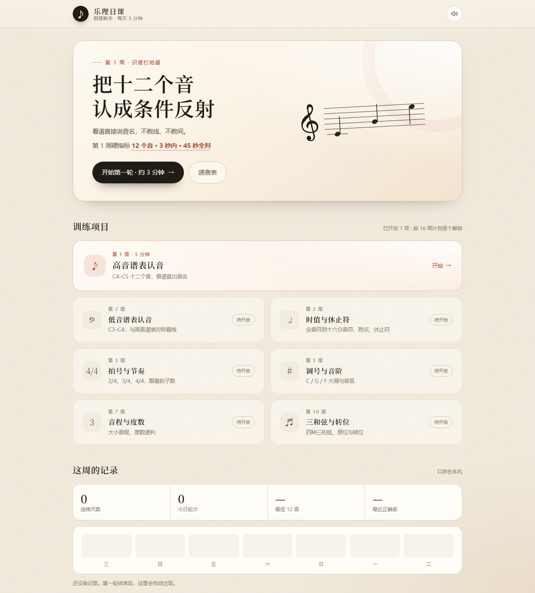
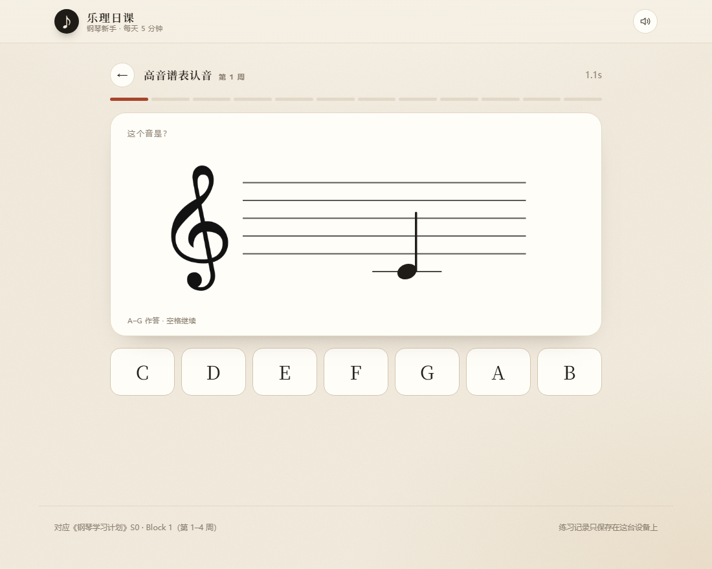

# 乐理日课

钢琴新手每天 5 分钟的乐理训练台。第一个技能包「高音谱表认音」对应《钢琴学习计划》第 1 周硬指标 ②：

> 高音谱表 C4–C5 十二个音，3 秒内说音名；12 张全对且 ≤ 45 秒。

纯静态网页，不联网、不安装、无账号。手机浏览器打开同样是竖屏布局。

在线版：<https://cheesy-crab.github.io/leriyueke/>



## 一、怎么打开

- 在线用：打开 <https://cheesy-crab.github.io/leriyueke/>，加书签即可。
- 离线用：双击 `index.html`，或双击 `启动.bat`（用默认浏览器打开）。
- 练习记录存在本机浏览器里（localStorage），换浏览器 / 换域名 / 清缓存会丢；在线版和本地版的数据互不相通。

## 二、这一版做了什么

- **12 音整轮**：随机顺序出谱，七选一作答，也可以直接按键盘 `A`–`G`（或 `1`–`7`）。
- **计时**：每题单独计时，超过 3 秒标黄；整轮总时间用于判 45 秒线。
- **即时反馈**：答对/答错都给音名、唱名、简谱、谱面位置；答错额外给「线上 EGBDF / 间里 FACE」的核对口诀。
- **错题重练**：整轮结束后，错的音自动再出一遍（不计成绩）；结果页可以「只练这几个音」，专项会补足 6 张。
- **结果与记录**：正确率、总用时、平均每题、慢题数、错题清单；首页有连续天数、今日轮次、最佳 12 音、最近正确率、7 天柱状图。
- **速查表**：12 个音逐个画在小谱表上，点一下能听音高，附两条口诀和三条禁忌（和纸卡版一致）。
- **提示音**：答对播放该音音高；可以随时关掉。



## 三、目录

```
piano-app/
  index.html            页面骨架 + 脚本加载顺序
  css/app.css           全部样式（纸感米白 + 墨色 + 朱砂）
  js/core/registry.js   技能注册表：所有训练项目在这里挂号
  js/core/store.js      本地进度（带 schema 版本号，可迁移）
  js/core/audio.js      极简音源，答对/答错音效，后续听音可复用
  js/core/staff.js      五线谱 SVG 渲染（高音/低音谱号、加线、符干）
  js/skills/note-treble.js  技能包 01：高音谱表认音
  js/skills/roadmap.js  未开放项目的占位（低音谱表、时值、音程……）
  js/ui/app.js          界面、答题流程、计分、存储、键盘
  assets/               谱号 PNG（由 tools/make_clefs.py 生成）
  tools/make_clefs.py   从系统音乐字体重做谱号素材
  preview/              README 用的截图
```

## 四、怎么加下一个功能

应用本身不认识「音符」。它只认技能包注册表里的接口，所以加功能不用改 `app.js`。

### 技能包契约

```js
PC.registerSkill({
  id: 'note-bass',            // 唯一 id
  title: '低音谱表认音',
  week: '第 2 周',
  desc: 'C3–C4，与高音谱表对称着练',
  status: 'live',             // live 才会出现「开始」
  // 以下五项是 live 技能必须实现的：
  buildSession(opts) {},      // 返回这一轮的卡片数组；opts.only 用于错题专项
  question(card) {},          // 谱面上方的问题文案
  renderPrompt(host, card) {},// 把题目画进 host（可用 PC.staff.render）
  options(card) {},           // 返回 [{ value, label }]
  isCorrect(card, value) {},  // 判分
  explain(card) {}            // { main, sub, hint?, freq? }
});
```

### 加一个「低音谱表」的步骤

1. 新建 `js/skills/note-bass.js`，照抄 `note-treble.js`，把 `clef` 改成 `'bass'`，换掉十二个音的位置数据（低音谱表 `pos: 0` = 最下面一线 G2，往上是 G2–F3–……）。
2. 在 `js/skills/roadmap.js` 里删掉 `note-bass` 的占位条目，避免 id 重复。
3. 在 `index.html` 里加一行 `<script src="js/skills/note-bass.js"></script>`。

`staff.js` 已经支持低音谱号和 `assets/bass-clef.png`，不需要改渲染器。

### 换一种题型

如果新项目不是「看谱选音名」（比如节奏题、音程题），在技能包里把 `renderPrompt` 画成自己的样子、`options` 返回自己的选项即可；`app.js` 的答题流程、计时、错题重练、结果页都能直接复用。真正需要新交互（拖拽、听辨）时，再在 `app.js` 里加一个任务类型分支。

## 五、已经留好的扩展点

- **注册表 + 路线图**：首页的「待开放」卡片就是 `roadmap.js` 里的数据，按计划第 2/3/5/7/10 周排好，改成 `live` 即上线。
- **五线谱渲染**：`PC.staff.render({ clef, space, top, width, height, x1, x2, notes })`，支持任意音符位置、加线、符干方向；调号、临时记号可以在这里继续加。
- **音源**：`PC.audio.note(freq)` / `PC.audio.wrong()`，后面的听音、音程、和弦技能直接调用。
- **存储**：`store.js` 带 `v` 版本号和 `migrate()`，以后加字段不会清空历史；`summary()` 是首页统计的唯一数据源。
- **计分口径**：整轮固定 12 题（`total === 12`）才判 45 秒达标；专项练习不计入周目标，避免自欺欺人。

## 六、这一版的边界

- 没有后端和多设备同步；数据只在这台设备的浏览器里。
- 错题只在「本轮」重练，还没有跨天的记忆曲线；如果后面需要，可以在 `store.js` 里按音名累计正确率，再让 `buildSession` 优先抽薄弱音。
- 没有做 PWA 安装（需要 https 或本地服务）；现在双击就能用，先不引入这层复杂度。
- 音频是合成音，不是钢琴采样；练耳够用，音色不追求。

## 七、部署

仓库根目录就是站点根目录，GitHub Pages 已配置为发布 `main` 分支根路径，不需要构建，也没有后端。

更新流程：

```bash
git add -A
git commit -m "更新说明"
git push
```

推送后 Pages 会自动重新发布，通常几十秒生效。

---

对应计划：S0 · Block 1（第 1–4 周）识谱阶段。纸卡版 PDF 在本地工作区（未随仓库上传），这个应用负责每天 5 分钟的计时训练和记录。
